# DEPTHGUARD 360
### Edge-Preserving Depth Map Upsampling & Refinement

<p align="center">
  <strong>CV Hackathon · Problem Statement 4 (ProbID: P4)</strong><br/>
  Turning sparse or low-resolution depth measurements into dense, high-resolution depth maps while preserving object boundaries and geometric structure.
</p>

---

## Overview

**DEPTHGUARD 360** is a computer-vision project focused on depth-map upsampling and refinement. The goal is to reconstruct high-resolution depth representations from sparse, noisy, or low-resolution depth inputs without blurring important object boundaries or introducing texture-copying artifacts.

When an RGB guidance image is available, the system uses its colour and structural cues to guide refinement while ensuring that RGB texture is not blindly copied into the depth map.

The proposed solution combines **classical computer vision**, **deep learning**, and a **hybrid reconstruction pipeline**. It is designed to support multiple upsampling scales and to be evaluated on depth accuracy, edge preservation, and runtime.

DEPTHGUARD 360 URL - https://cv-hackathon-production-25bb.up.railway.app/

> **Project status:** Problem definition and proposed technical approach. Implementation details, datasets, trained weights, quantitative results, and deployment links should be added as they become available. No performance results are claimed in this README.

## Problem Statement

### The challenge

Given a sparse or low-resolution depth map—and optionally a corresponding RGB image—reconstruct a dense, high-resolution depth map that:

- Preserves sharp boundaries between foreground and background objects.
- Retains geometric structures and depth discontinuities.
- Handles missing depth values, holes, and sensor noise.
- Avoids oversmoothing and texture-copying artifacts.
- Works across different upsampling factors, including **2×, 4×, and 8×**.

### Why it matters

Conventional interpolation can enlarge a depth map, but it often smooths object edges and spreads incorrect depth values across boundaries. Real-world depth sensors can also produce incomplete or noisy measurements. Edge-aware reconstruction is therefore important for applications such as robotics, autonomous navigation, 3D scene understanding, augmented reality, and object perception.

## Objectives

1. Build a reliable baseline using standard interpolation techniques.
2. Apply edge-aware classical filtering and depth refinement.
3. Implement or adapt a deep-learning model for depth completion or depth super-resolution.
4. Incorporate RGB guidance where available without copying irrelevant image texture.
5. Combine classical and learned methods into a hybrid reconstruction pipeline.
6. Compare methods at multiple scales and test on unseen depth maps.
7. Evaluate both numerical depth accuracy and visual boundary quality.

## Proposed Solution

EdgeDepth is organised into three reconstruction approaches, followed by a comparative evaluation stage.

### 1. Classical Computer Vision

Establish interpretable baselines and edge-aware refinement methods:

| Technique | Purpose |
|---|---|
| Nearest-neighbour interpolation | Simple baseline that preserves existing sample values |
| Bilinear interpolation | Smooth interpolation using neighbouring samples |
| Bicubic interpolation | Higher-order interpolation baseline |
| Joint bilateral filtering | Refines depth using spatial and RGB similarity |
| Guided filtering | Uses a guidance image to preserve aligned structures |
| Edge detection | Identifies image boundaries for boundary-aware processing |
| Depth discontinuity detection | Detects abrupt changes in depth |
| Noise removal and hole filling | Reduces measurement noise and fills invalid regions |

### 2. Deep Learning

Implement or adapt a depth-completion or depth-super-resolution network.

Candidate approaches include:

- CNN-based depth refinement networks.
- Guided depth super-resolution networks.
- Transformer-based depth models.

The model should learn to reconstruct missing depth information and refine coarse depth structures. Where RGB guidance is available, the network can use colour and structural features alongside depth measurements.

**Training and adaptation plan:**

1. Select a suitable depth dataset with aligned RGB and depth data where available.
2. Prepare low-resolution or sparse depth inputs from higher-quality depth maps.
3. Train or fine-tune the selected architecture using suitable reconstruction losses.
4. Validate on held-out samples and tune the model.
5. Test on unseen depth maps to assess generalisation.

Possible loss components include depth reconstruction loss (L1 or L2), gradient or edge-aware loss, and valid-pixel masking for missing measurements.

### 3. Hybrid Depth Reconstruction

Combine the strengths of classical methods and deep learning:

- Generate an initial high-resolution depth estimate using interpolation.
- Use RGB guidance and edge-aware filtering to refine aligned structures.
- Apply a learned refinement model to recover detail and handle difficult missing regions.
- Detect depth discontinuities and apply boundary-aware refinement.
- Preserve valid depth measurements and suppress texture-copying artifacts.

The exact order and fusion strategy will be selected through experiments. The hybrid output should be compared against each individual method rather than assumed to be better.

## System Workflow

```mermaid
graph LR
    subgraph INPUT["INPUT DATA"]
        RGB["RGB Image<br/>High-resolution<br/>Colour & Texture"]
        DEPTH["Low-Res Depth Map<br/>Sparse/Noisy<br/>LiDAR Sensor"]
        MASK["Depth Validity Mask<br/>Valid/Missing Pixels"]
        TEMPORAL["Optional Temporal Frames<br/>Prev/Next RGB & Depth<br/>Video Mode Only"]
        style TEMPORAL stroke:#999,stroke-dasharray: 5 5
    end
    
    subgraph PREPROC["DATA PREPROCESSING & ALIGNMENT"]
        ALIGN["Spatial Alignment<br/>RGB-Depth Registration"]
        RESIZE["Image Resizing<br/>Scale Preparation"]
        NORM["Depth Normalization<br/>Validity Mask Gen"]
        QUALITY["Quality Checks<br/>Corruption Generation"]
        SCALES["Upsampling Factors<br/>2× | 4× | 8×"]
        style SCALES stroke:#fb923c,fill:#fff7ed
    end
    
    subgraph MODULES["SIX INTELLIGENT MODULES"]
        M1["DEPTH RESCUE<br/>Depth Damage Diagnosis<br/>Identifies Missing/Noise<br/>Boundary Corruption"]
        M2["DEPTHGUARD<br/>Confidence-Aware Analysis<br/>Pixel-Level Uncertainty<br/>Reliability Map"]
        M3["OCCLUSION-X<br/>Object Relationships<br/>Foreground/Background<br/>Boundary Prevention"]
        M4["TEXTURE TRAP<br/>Texture vs Depth Edge<br/>Prevents False Boundaries<br/>Pattern Artifacts"]
        M5["TEMPORAL DEPTH REPAIR<br/>Video Frame Recovery<br/>Motion Estimation<br/>Temporal Alignment"]
        M6["GEOMETRY FIRST<br/>Geometric Consistency<br/>Surface Normals<br/>Plane Fitting Analysis"]
        style M1 stroke:#818cf8,fill:#eef2ff
        style M2 stroke:#2dd4bf,fill:#f0fdfa
        style M3 stroke:#a78bfa,fill:#f5f3ff
        style M4 stroke:#fb923c,fill:#fff7ed
        style M5 stroke:#38bdf8,fill:#f0f9ff
        style M5 stroke:#999,stroke-dasharray: 5 5
        style M6 stroke:#4ade80,fill:#f0fdf4
    end
    
    subgraph ENGINE["HYBRID DEPTH RECONSTRUCTION ENGINE"]
        CLASSICAL["Classical Methods<br/>Bilinear Interpolation<br/>Bilateral Upsampling<br/>Guided Filtering"]
        DEEP["Deep Learning<br/>Shared RGB-Depth Features<br/>Multi-Scale Fusion<br/>U-Net Reconstruction"]
        FUSION["Adaptive Fusion<br/>Confidence-Aware<br/>Boundary-Guided<br/>Measurement Preservation"]
        style CLASSICAL stroke:#f87171,fill:#fef2f2
        style DEEP stroke:#a78bfa,fill:#f5f3ff
        style FUSION stroke:#facc15,fill:#fefce8
    end
    
    subgraph REFINE["BOUNDARY-AWARE & GEOMETRIC REFINEMENT"]
        DISCON["Discontinuity Preservation"]
        EDGE["Edge-Aware Refinement"]
        NOISE["Noise Reduction<br/>Hole Filling"]
        GEOM["Surface-Normal Consistency<br/>Geometric Refinement"]
        QCHECK["Quality Checks"]
    end
    
    subgraph OUTPUT["FINAL OUTPUTS"]
        DEPTHOUT["High-Resolution<br/>Refined Depth Map"]
        CONFOUT["Pixel-Level<br/>Confidence Map"]
        BOUNDOUT["Depth Boundary<br/>Occlusion Map"]
        REPORT["Quality Report<br/>RMSE | MAE | PSNR | SSIM<br/>Edge Preservation<br/>Latency | Memory"]
        style REPORT stroke:#fb7185,fill:#fff1f2
    end
    
    subgraph EVAL["EVALUATION & APPLICATION"]
        DATASETS["Benchmark Datasets<br/>KITTI Depth Completion<br/>NYU Depth V2<br/>Middlebury Stereo"]
        EXPERIMENTS["Experiments<br/>2× | 4× | 8× Upsampling<br/>Classical vs DL vs Hybrid<br/>Baseline Comparison"]
        DEMO["Streamlit<br/>Demonstration App"]
        style DEMO stroke:#2dd4bf,fill:#f0fdfa
    end
    
    RGB --> ALIGN
    DEPTH --> ALIGN
    MASK --> ALIGN
    TEMPORAL -.-> ALIGN
    ALIGN --> RESIZE
    RESIZE --> NORM
    NORM --> QUALITY
    QUALITY --> SCALES
    
    SCALES --> M1
    SCALES --> M2
    SCALES --> M3
    SCALES --> M4
    SCALES --> M5
    SCALES --> M6
    
    M1 -->|Damage Diagnosis| FUSION
    M2 -->|Confidence Map| FUSION
    M3 -->|Occlusion Guidance| FUSION
    M4 -->|Boundary Guidance| FUSION
    M5 -.->|Temporal Recovery| FUSION
    M6 -->|Geometric Guidance| FUSION
    
    CLASSICAL --> FUSION
    DEEP --> FUSION
    FUSION --> DISCON
    
    DISCON --> EDGE
    EDGE --> NOISE
    NOISE --> GEOM
    GEOM --> QCHECK
    
    QCHECK --> DEPTHOUT
    QCHECK --> CONFOUT
    QCHECK --> BOUNDOUT
    QCHECK --> REPORT
    
    DEPTHOUT --> DATASETS
    CONFOUT --> EXPERIMENTS
    BOUNDOUT --> DEMO
    REPORT --> EXPERIMENTS
    
    classDef inputStyle stroke:#818cf8,fill:#eef2ff
    classDef processStyle stroke:#2dd4bf,fill:#f0fdfa
    classDef outputStyle stroke:#fb7185,fill:#fff1f2
    classDef modulesStyle stroke:#a78bfa,fill:#f5f3ff
    classDef engineStyle stroke:#facc15,fill:#fefce8
    
    class INPUT inputStyle
    class PREPROC processStyle
    class REFINE processStyle
    class OUTPUT outputStyle
    class EVAL processStyle
    class ENGINE engineStyle

```



## Advanced Requirements

| Requirement | Planned support |
|---|---|
| Multiple upsampling factors | 2×, 4×, and 8× |
| Missing depth values | Validity masks, hole filling, and learned completion |
| Noisy measurements | Denoising and robust refinement |
| RGB-guided reconstruction | Colour and structural guidance where available |
| Method comparison | Interpolation vs. classical vs. deep learning vs. hybrid |
| Unseen data evaluation | Held-out test samples |
| Boundary analysis | Visual crops and edge/discontinuity metrics |

## Evaluation Metrics

The system will be evaluated using complementary numerical and visual measures.

| Metric | What it measures | Desired direction |
|---|---|---|
| RMSE | Root mean squared depth error; penalises larger errors | Lower |
| MAE | Mean absolute depth error | Lower |
| PSNR | Reconstruction quality relative to a reference | Higher |
| SSIM | Structural similarity where appropriate | Higher |
| Edge preservation | Retention of important depth boundaries | Higher |
| Boundary accuracy | Alignment of reconstructed depth discontinuities with reference boundaries | Higher |
| Processing latency | Time required to reconstruct a depth map | Lower |
| Memory consumption | Runtime memory requirement | Lower |

Metrics should be computed over valid depth pixels, with consistent depth units and evaluation masks. PSNR and SSIM should be reported only with a clearly defined normalisation range and where their assumptions are appropriate.

### Experiment comparison

Use the same test samples and upsampling factors for all approaches.

| Method | 2× RMSE / MAE | 4× RMSE / MAE | 8× RMSE / MAE | Edge quality | Latency |
|---|---|---|---|---|---|
| Nearest neighbour | TBD | TBD | TBD | TBD | TBD |
| Bilinear | TBD | TBD | TBD | TBD | TBD |
| Bicubic | TBD | TBD | TBD | TBD | TBD |
| Classical refinement | TBD | TBD | TBD | TBD | TBD |
| Deep learning | TBD | TBD | TBD | TBD | TBD |
| Hybrid reconstruction | TBD | TBD | TBD | TBD | TBD |

*TBD values should be filled with measured results after experiments. Do not treat placeholders as experimental findings.*

## Technology Stack

The final stack will depend on the selected model and deployment environment. A suitable starting point is:

- **Language:** Python
- **Computer vision:** OpenCV
- **Numerical processing:** NumPy, SciPy
- **Deep learning:** PyTorch or TensorFlow
- **Image processing and visualisation:** Matplotlib
- **Application interface:** Streamlit or Gradio (if a web demo is selected)
- **Version control:** Git and GitHub

## Proposed Repository Structure

```text
CV-hackathon/
├── README.md
├── data/
│   ├── raw/
│   ├── processed/
│   └── README.md
├── notebooks/
│   ├── 01_data_exploration.ipynb
│   ├── 02_classical_baselines.ipynb
│   └── 03_model_evaluation.ipynb
├── src/
│   ├── preprocessing/
│   ├── classical/
│   ├── models/
│   ├── hybrid/
│   └── evaluation/
├── app/
├── tests/
├── configs/
├── requirements.txt
└── .gitignore
```

This is a suggested structure; folders can be added as the corresponding components are implemented. Large datasets and model checkpoints should generally be managed outside ordinary Git commits, with download instructions or suitable storage links documented instead.

## Getting Started

### 1. Clone the repository

```bash
git clone https://github.com/ayushbhanja818-create/CV-hackathon.git
cd CV-hackathon
```

### 2. Create a virtual environment

```bash
python -m venv .venv
```

Activate it:

**macOS / Linux**
```bash
source .venv/bin/activate
```

**Windows**
```bash
.venv\\Scripts\\activate
```

### 3. Install dependencies

Once `requirements.txt` has been populated:

```bash
pip install -r requirements.txt
```

### 4. Run the application

The application entry point and exact run command will be documented here after the deployment interface is implemented.

## Expected Deliverable

A deployed intelligent depth-reconstruction application that accepts low-resolution or sparse depth maps, optionally uses an RGB guidance image, and produces high-resolution depth maps. It should demonstrate improvements in depth accuracy and boundary preservation over conventional interpolation baselines, supported by reproducible experiments on unseen data.


## Acknowledgements

This project is developed for **CV Hackathon – Problem Statement 4 (P4): Edge-Preserving Depth Map Upsampling and Refinement Challenge**.

---

<p align="center">
  <strong>EdgeDepth · Reconstructing depth while preserving structure</strong>
</p>
